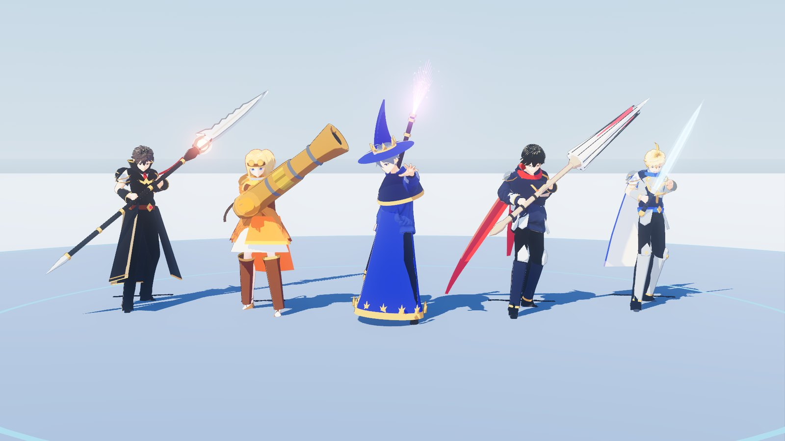
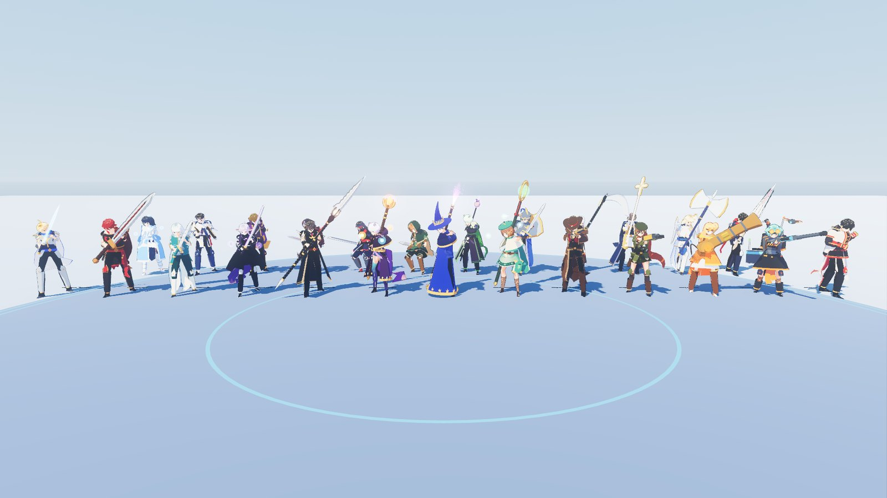
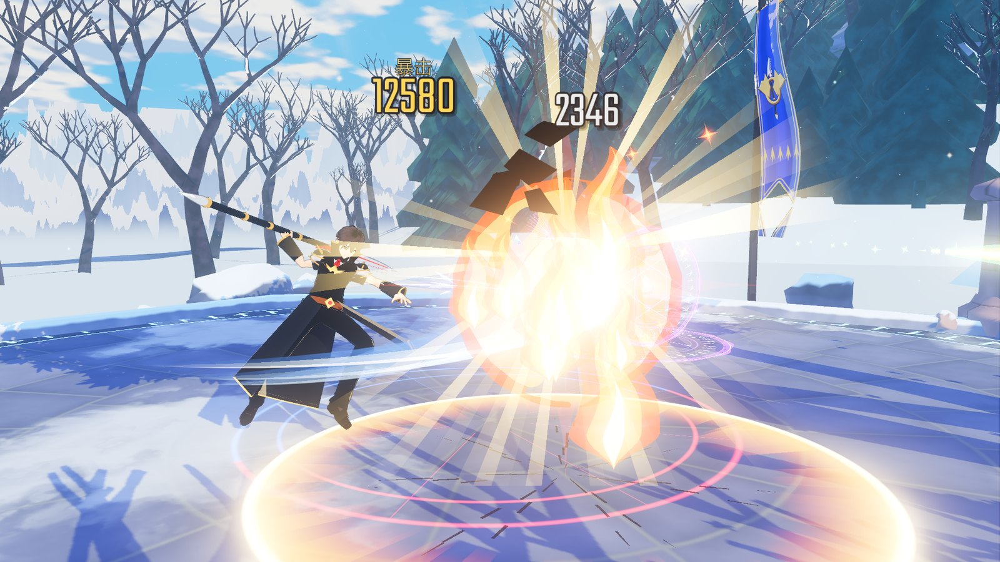
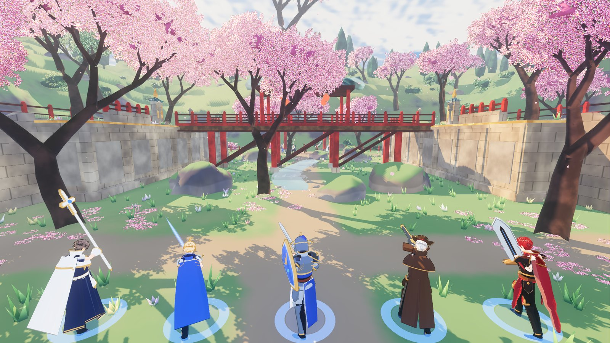
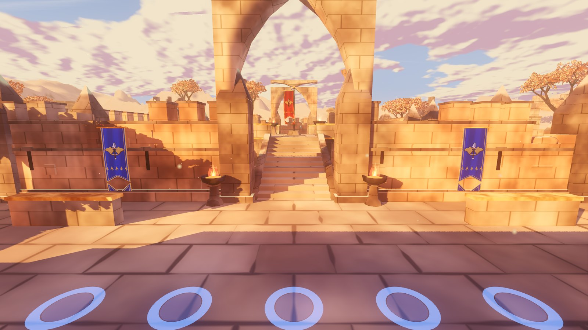
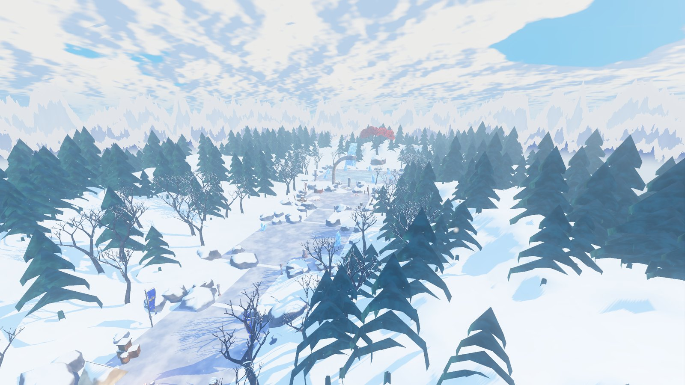
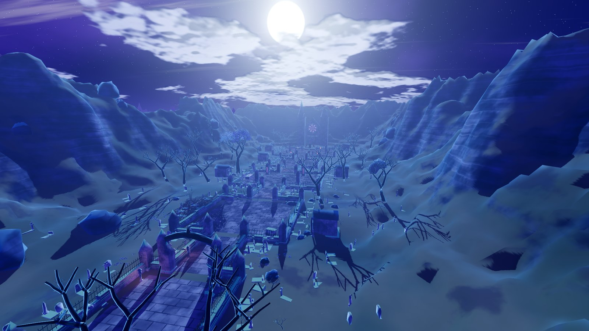

# Rongyao Arena 荣耀竞技场

A fan-made, class-based team arena game inspired by **Glory (荣耀)**, the in-story MMO of
**全职高手 / The King's Avatar**. Pick one of 25 classes, master its combos and fight 1v1, 3v3 or 5v5 —
or take a party into a raid. No levels, no grinding: every character is ready to fight.

> **Unofficial fan project.** Not affiliated with or endorsed by Tencent, China Literature (阅文),
> 蝴蝶蓝 or the animation studios. All art, music and sound are original or free-licensed
> (see [`assets/CREDITS.md`](assets/CREDITS.md)).



## Download

**[Releases page](https://github.com/chon9/GloryOnline/releases)** (download the newest `RongyaoArena-*-windows-x64.zip`) — Windows 10/11 64-bit.
Unzip anywhere and run `RongyaoArena.exe`. Windows SmartScreen may warn because the exe is not
code-signed: choose **More info → Run anyway**.

Requirements: a GPU with DirectX 12 or Vulkan support (GTX 900 / RX 400 series or newer). Steam is optional.

## Features

- **25 classes** — all 24 Glory classes across the six base classes, plus **散人 Unspecialized** with the
  transforming **千机伞** umbrella:
  - 剑士系 Swordsman: 剑客 Blade Master · 狂剑士 Berserker · 魔剑士 Spellblade · 鬼剑士 Ghostblade
  - 法师系 Mage: 战斗法师 Battle Mage · 元素法师 Elementalist · 魔道学者 Witch · 召唤师 Summoner
  - 枪手系 Gunner: 神枪手 Sharpshooter · 弹药专家 Spitfire · 枪炮师 Launcher · 机械师 Mechanic
  - 格斗系 Fighter: 拳法家 Striker · 气功师 Qi Master · 柔道 Grappler · 流氓 Brawler
  - 暗夜系 Nightwalker: 刺客 Assassin · 忍者 Ninja · 盗贼 Thief · 术士 Warlock
  - 圣职系 Priest: 骑士 Knight · 驱魔师 Exorcist · 牧师 Cleric · 守护天使 Paladin
- **8 canon skills per class** with each class's canon weapon, and Glory-style combat: launch and air juggles
  with combo protection, knockdown and **受身** quick recovery, super armor, armor-breaking grabs, block,
  back attacks, stealth and taunts.
- **Modes** — 个人赛 Duel (1v1, best of 3) · 擂台赛 Group Arena (3v3, winner stays on) ·
  团体赛 Team Battle (up to 5v5, best of 3) · 副本 Raid (5 players):
  冰霜森林 Frost Forest (boss: 冰霜巨人 Frost Golem) and 埋骨之地 Burial Grounds (boss: 黑骑士 Black Knight),
  each boss with three phases, telegraphed mechanics and an enrage.
- **AI bots** fill any empty slot, with 4 difficulty levels.
- **Multiplayer** through Steam lobbies and invites (Steam's free test app 480 "Spacewar"), or LAN / direct IP.
- **Anime look** — toon-shaded characters, painted maps, anime skill effects with hit-stop, painted skill icons
  and a 国漫-style HUD.
- **Audio** — recorded sound effects for every weapon and element, East-Asian-flavoured music that follows
  the match (menu, lobby, battle, raid, boss, enrage, victory/defeat) and ambient sound for every map.

| | |
|---|---|
|  |  |
|  |  |
|  |  |

## Controls

| Key | Action |
|---|---|
| WASD / Mouse | Move / aim and camera |
| Space | Jump; press as you land after a knockdown for quick recovery 受身 |
| Left mouse | Basic attack chain |
| Right mouse, Q, E, R, F, 1 | Skills |
| 2 | Ultimate 大招 |
| Tab / Middle mouse | Cycle lock-on target / toggle lock-on |
| Mouse wheel | Zoom |
| ` (backtick) | Scoreboard |
| F1 | Skill list for your class |
| Esc | Pause and settings |

Settings: volume per bus (Master, Music, SFX, UI, Ambience), mouse sensitivity, bot difficulty,
own / ally / enemy effect intensity and camera shake.

## Playing with friends

- **Steam:** everyone needs the Steam client running and logged in before starting the game. Host with
  **创建房间 Host (Steam)** and **邀请好友 Invite Friends**; friends accept the invite or use
  **浏览房间 Browse Lobbies**. Steam shows you as "playing Spacewar" — that's expected. Two copies on one PC
  with one Steam account can't join each other through Steam; use LAN for that.
- **LAN / direct IP:** **局域网 LAN Host/Join** → **创建局域网房间 Host LAN** (UDP port 27777; forward it on the
  host's router for internet play). Allow the Windows Firewall prompt the first time you host. Friends enter
  the host's IP and press **加入 Join**. Start with `RongyaoArena.exe -- --no-steam` to skip Steam.

More detail: [`docs/MULTIPLAYER.md`](docs/MULTIPLAYER.md).

## Building from source

1. Install **Godot 4.7.2** (standard build). The GodotSteam GDExtension is already in `addons/godotsteam`.
2. Open `project.godot` in the editor and press Play, or run
   `godot --path . ` from the repository root.
3. To export, install the 4.7.2 export templates and use the **Windows Desktop** preset in `export_presets.cfg`.
   Put `steam_appid.txt` (containing `480`) next to the exported exe so Steam works outside the Steam launcher.

Tests are headless Godot scripts in `tests/`:

```
godot --headless --path . -s res://tests/test_core_combat.gd
```

Each suite prints a `... TESTS: X passed, Y failed` line. `test_core_net.gd` and `test_net_enet.gd` run as two
processes (`-- --role=host` and `-- --role=client`).

## Project layout

| Folder | Contents |
|---|---|
| `core/` | Combat engine: fighters, skill runner, hits and statuses, projectiles, area effects, networking sync, camera |
| `classes/` | The 25 class kits (skills as data-driven action timelines) |
| `ai/`, `pve/` | Bot AI; raid dungeons, mobs and boss AI |
| `maps/`, `modes/` | PvP arenas; duel, group arena, team and raid match rules |
| `visuals/` | Anime character pipeline, class outfits, weapons, VFX, shaders |
| `autoload/` | Steam/LAN networking, game flow, effects, music, class registry |
| `ui/` | Menus, lobby, HUD |
| `assets/` | Third-party and generated art, audio and fonts (licenses in `assets/licenses/`) |
| `tools/icons/` | The code-drawn skill icon generator |
| `docs/` | Architecture contract, art bible, multiplayer guide |

## Credits

Built with [Godot Engine](https://godotengine.org) and [GodotSteam](https://godotsteam.com).
Characters from the VRoid Project sample models, animations from Mesh2Motion and KayKit, sounds and UI from
Kenney and other CC0 / CC-BY creators, music by Kevin MacLeod (incompetech.com) and others, fonts under the
SIL Open Font License. The full list with exact attributions is in [`assets/CREDITS.md`](assets/CREDITS.md)
and on the in-game credits screen.

## Contributing

Bug reports, balance feedback and pull requests are welcome — see [`CONTRIBUTING.md`](CONTRIBUTING.md) for setup,
tests, conventions and the asset-licensing rules. Report issues in
[Issues](https://github.com/chon9/GloryOnline/issues).

## License

The source code and the project's original assets are released under the [MIT License](LICENSE).
Third-party assets in `assets/` keep their own licenses (CC0, CC BY, SIL OFL, VRoid Hub license), listed in
[`assets/CREDITS.md`](assets/CREDITS.md); GodotSteam and Godot Engine are MIT. The Glory / 全职高手 / The King's Avatar
names and characters belong to their owners and are not licensed by this repository.
